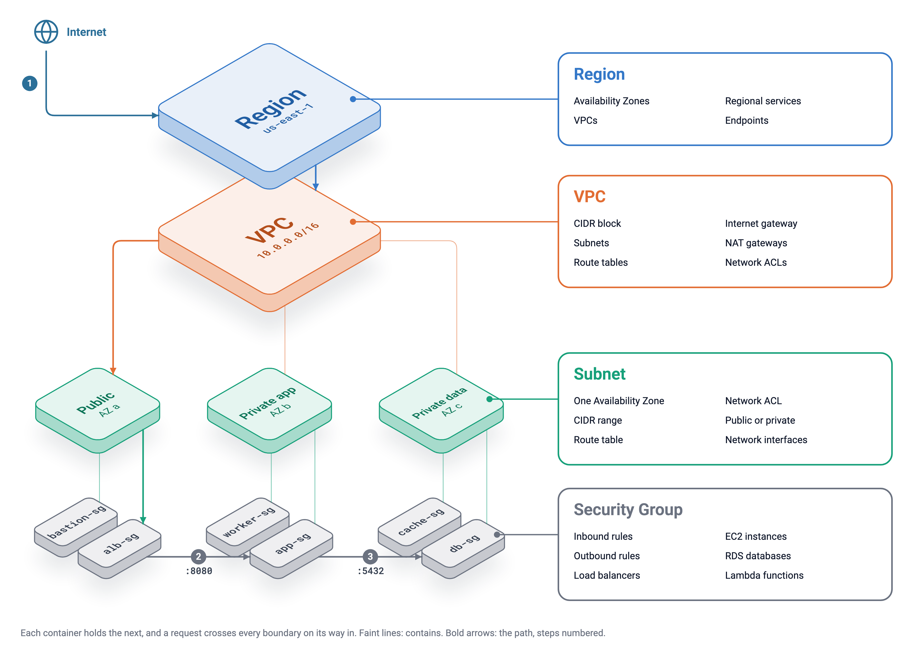
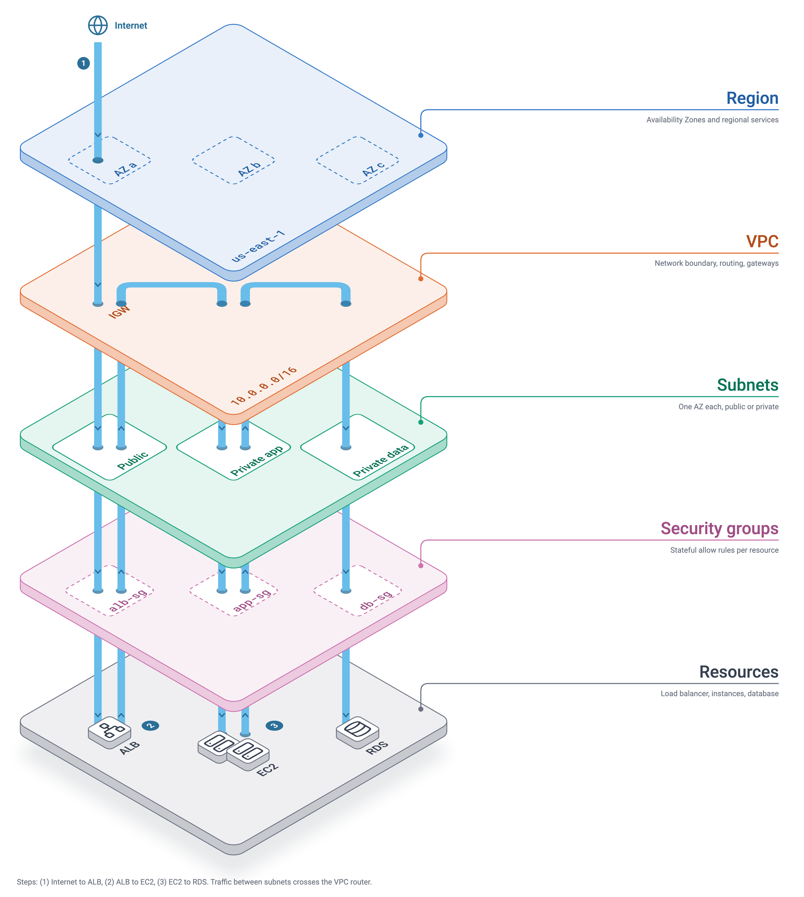

# iso-diagram skill

## Overview

This skill creates isometric diagrams in 2 opinionated styles with text callouts and simplified detail. I got the idea from diagrams like the one in [this Scalr doc](https://docs.scalr.io/docs/structuring-scalr), and wanted to be able to use that diagram type elsewhere.

### `iso-tree`

An isometric hierarchy diagram which displays a multi-layered set of entities which may have multiple children as the diagram moves downwards.




### `iso-stack`

Also called an "exploded" or "exploded isometric view", this type of diagram displays several layers as self-contained "slabs" whose child items may be connected by a through-connector.



The default output is `svg`, but it also supports `png`. The assumption is that the user or agent invoking the skill can utilize a separate tool to convert the `svg` output into other image formats.

## Style

This skill has a default set of fonts, icons, color palettes, and design principles which guide the creation of each diagram. You may provide customization options as part of the skill invocation to change these.

### Requirements

- [`uv`](https://docs.astral.sh/uv/getting-started/installation/) installs the skill's Python dependencies and runs its scripts.
- Chrome or Chromium, for PNG export only. SVG output works without it.
- Network access on first use. `uv` downloads the Python dependencies, and the skill downloads each icon the first time a diagram uses it.

### Installation

Use the [GitHub CLI](https://cli.github.com/manual/gh_skill_install) to install the skill. Note that you must have permission to write to the installation target.

The `--scope user` flag installs the skill in your home directory. Remove it to install the skill in your current path.

**From GitHub**

```sh
gh skill install https://github.com/JoBrad/agent-skill-iso-diagram --scope user
```

**From a local path**

```sh
gh skill install path-to-the-skill --from-local --scope user
```

You can also use the [--agent](https://cli.github.com/manual/gh_skill_install) flag to directly specify a specific agent for the installation target.

```sh
gh skill install https://github.com/JoBrad/agent-skill-iso-diagram --agent claude-code --scope user
```


## License

License detail is in [LICENSE](./LICENSE). Note that this skill includes bundled fonts, and downloads Feather and Lucide icons on first use. Both have their own licenses which should be respected.

In short: Feel free to copy it, but keep it open, and please contribute your changes here. :)
